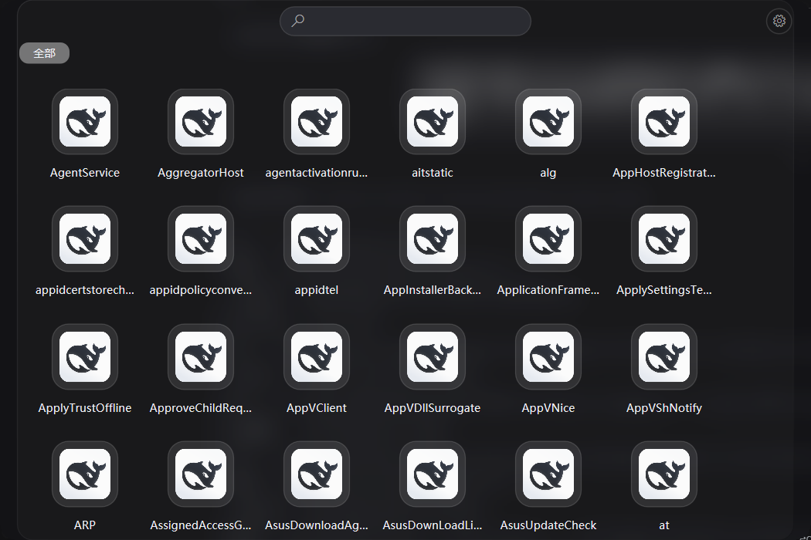
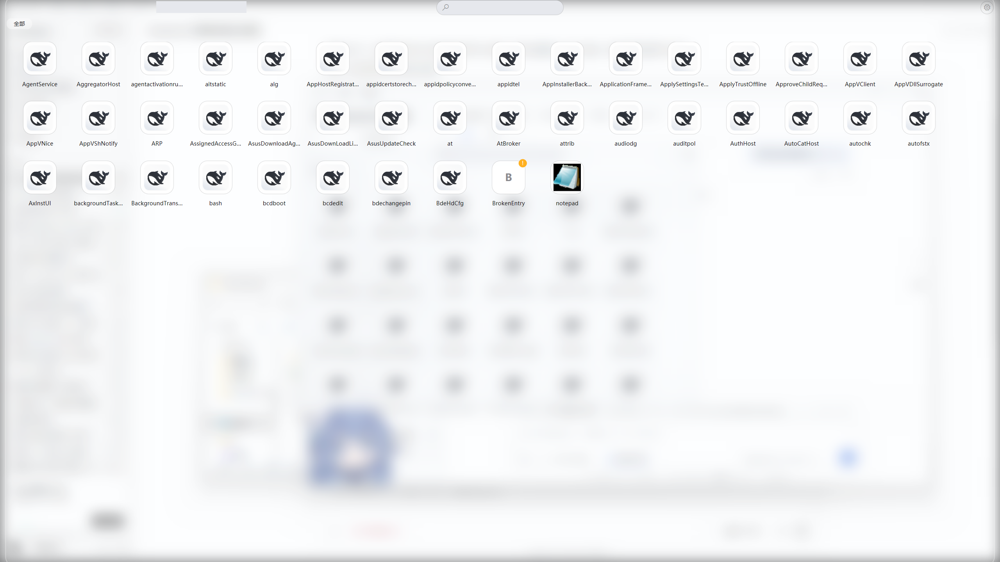

# GlassLauncher Native

一个仿 macOS Launchpad 的 Windows 玻璃质感启动器 —— **C++17 + Win32/Direct2D 原生重写版**。

没有 .NET、没有 WPF、没有运行时要装的东西：整个程序就是一个约 **540 KB 的单文件 exe**。



## 为什么重写

原来的 WPF 版功能完整，但内存占用天生下不来：一个空 WPF 窗口私有工作集就 ~40 MB、
提交 73 MB，加 Acrylic 后可见态 44–57 MB、冷启动 ~1.3 s。

原生版把渲染换成 Direct2D + DirectWrite + WIC，背景模糊自己用 GDI 抓帧 + 盒式模糊算，
在同样功能下做到：

| 指标 | WPF 版 | 原生版 |
| --- | --- | --- |
| 空闲私有工作集 | 44–57 MB | **18–25 MB** |
| 私有提交 | 84–96 MB | ~75 MB |
| 冷启动 | ~1.3 s | **330–380 ms** |
| exe | ~1.5 MB + .NET 运行时 | **~540 KB，无运行时** |
| 空闲线程 | 34–36 | 15–26 |

> 在 Windows 11 26300、DPI 125% 上实测；内存口径 = 任务管理器"内存（专用工作集）"。

## 功能

- **毛玻璃窗口**：截图排除 + 实时桌面模糊背景，拖动/缩放时背景跟着桌面流动，松手无闪；
- **图标网格**：自动从开始菜单等导入，支持搜索过滤、拖拽排序、外部文件拖入；
- **右键菜单**：打开 / 以管理员身份运行 / 在资源管理器中定位 / 移除 / 重命名 / 重新指定目标；
- **失效快捷方式**角标（自动检查，可在设置里关闭）；
- **托盘**：左键显示/隐藏，右键菜单（打开、设置、退出）；
- **全局热键**：默认 `Alt+G`，可在设置里改；
- **自启**、**置顶**、**主题**（亮/暗/跟随系统）、**模糊半径**、**截图排除** 设置；
- **macOS Launchpad 式交互**：失去前台自动淡出收起；窗口淡入/淡出；图标悬停放大；
- **无边框窗口**：可拖动、可缩放（非模态）、双击标题最大化、自定义圆角；拖到屏幕左右边缘吸附半屏、拖到顶部最大化。



## 构建

只依赖一个 MinGW-w64 工具链（GCC，含 `g++` 和 `windres`），推荐 [w64devkit](https://github.com/skeeto/w64devkit)：

```powershell
# 默认输出 dist/GlassLauncherNative.exe
pwsh -File src/GlassLauncher.Native/build.ps1

# 或者指定输出目录
pwsh -File src/GlassLauncher.Native/build.ps1 -OutDir D:\build
```

如果 `g++`/`windres` 不在 PATH 里，先把 w64devkit 的 `bin` 加进 PATH。

## 运行

双击 `GlassLauncherNative.exe` 即可。数据与设置存放在：

```
%LOCALAPPDATA%\GlassLauncher\launcher-data.json
%LOCALAPPDATA%\GlassLauncher\settings.json
```

首次启动会自动导入开始菜单里的应用。托盘图标右键可以打开设置。

## 技术实现

- **渲染**：Direct2D（硬件加速）+ DirectWrite 文本，WIC 加载图标/PNG；
- **背景模糊**：worker 线程 `BitBlt`（COLORONCOLOR）抓窗口外扩 48 DIP 的桌面 → 半分辨率 DIB →
  三次盒式模糊 → 双缓冲交给 UI 线程 `CopyFromMemory`；UI 线程只做上传，8 ms 的拖动计时器不卡；
- **截屏排除**：`SetWindowDisplayAffinity(WDA_EXCLUDEFROMCAPTURE)`，用户截图/录屏看不到窗口；
- **无边框窗口**：`WS_POPUP | WS_THICKFRAME` + `WM_NCCALCSIZE` 铺满 + `SetWindowRgn` 圆角；
  拖动/缩放用 8 ms 计时器 + `SetWindowPos`，不进 `WM_ENTERSIZEMOVE`；
- **动画**：分层窗口 alpha 淡入/淡出（180 ms）；悬停放大用 16 ms 节拍 + smoothstep；
- **图标**：`ExtractIconEx` 提取 exe 图标 → WIC PNG 编码 → D2D bitmap；失效项角标自动检查。

## 已知限制

- 需要 Windows 10 2004+（截图排除 API）与 Windows 11 的更佳圆角/阴影效果；在 Win11 26300 上验证；
- 最小窗口尺寸 680×460；每行图标数量随宽度自适应；
- 频繁显示/隐藏时，本机 Win11 预览版上每次前台激活会有约 10–25 个内核句柄的系统级增长
  （多次 A/B 排除了分层窗口、DWM 属性、圆角区域、搜索框聚焦等因素；不影响内存/CPU/功能）。

## License

未声明 License。如需二次分发/商用，请先联系仓库所有者。
